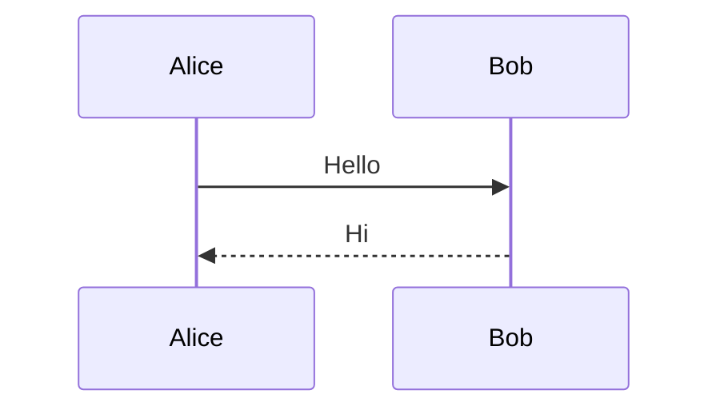
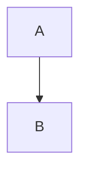

# Mermaid Diagram Rendering Implementation Plan

> **For agentic workers:** REQUIRED SUB-SKILL: Use superpowers:subagent-driven-development (recommended) or superpowers:executing-plans to implement this plan task-by-task. Steps use checkbox (`- [ ]`) syntax for tracking.

**Goal:** Auto-render `mermaid` code blocks inside Primer artifacts (both HTML and Markdown uploads) into inline SVG at view time, driven by the existing companion script.

**Architecture:** A pinned Mermaid UMD bundle is vendored into the API package and served same-origin at a versioned URL. The existing companion script (`apps/api/src/companion/v1.js`) gets a new init step that detects canonical Mermaid blocks, skips the document entirely when the author already loads Mermaid, otherwise lazy-imports the vendored bundle and renders each block to SVG. Theme follows the artifact's `<html data-theme>` and re-renders when the parent posts `theme_changed`.

**Tech Stack:** Plain JS (companion runs in an iframe with no module system), Hono route handler, Vitest with jsdom for testable DOM logic. No new npm dependencies.

**Reference design:** `docs/superpowers/specs/2026-06-22-mermaid-rendering-design.md`

**Test commands:**
```bash
pnpm --filter @primer/api typecheck
pnpm --filter @primer/api exec vitest run <path>
pnpm --filter @primer/api build
```

## Global Constraints

- **No new npm dependencies.** Mermaid is vendored as a plain JS file. `pnpm install` and `pnpm-workspace.yaml` are untouched.
- **No artifact CSP changes.** `script-src 'self'` already covers the same-origin bundle; `connect-src 'none'` stays in force.
- **No sanitizer allowlist changes.** Canonical Mermaid blocks already survive `sanitize-html` (the `class` attribute on `pre`/`code` is allowed by the `*` rule, and both tags are allowlisted).
- **Companion script is plain ES2020 in an IIFE.** No imports, no bundler. Testable logic is mirrored in `.test.ts` files (same pattern as `textRangePosition.test.ts`).
- **Conservative skip rules.** If the document already loads Mermaid itself (`<script src=…mermaid…>`, inline `mermaid.initialize`/`mermaid.run`, or pre-defined `window.mermaid`), Primer does not touch any block in that document.
- **Per-block failure never breaks the page.** A bad block keeps its source and gets an inline error note; siblings still render.
- **Mermaid version pin:** use `11.4.1` throughout this plan. If the engineer determines that version is stale or has a known render bug, they may pin a newer stable v11.x release — but update every reference in this plan to match before continuing.

---

## File Structure

**New (API):**
- `apps/api/src/companion/mermaid-v11.4.1.js` — vendored Mermaid UMD bundle (curl'd, committed verbatim).
- `apps/api/src/companion/MERMAID.md` — audit log: pinned version, source URL, SHA-256, date vendored.
- `apps/api/src/companion/mermaidVersion.ts` — exports the `MERMAID_VERSION` constant used by the route and any TS consumer.
- `apps/api/src/routes/mermaidAsset.ts` — Hono route serving the bundle at `/companion/mermaid-v<version>.js`.
- `apps/api/src/routes/mermaidAsset.test.ts` — route tests.
- `apps/api/src/companion/mermaidScanner.test.ts` — mirror tests for the scanner + skip-condition logic in `v1.js`.

**Modified (API):**
- `apps/api/src/companion/v1.js` — adds detection scanner, skip-conditions, lazy bundle load, render loop, theme re-render hook.
- `apps/api/src/routes/companion.test.ts` — extended with a sanity assertion that the new `mermaid` init hook appears in the served body.
- `apps/api/src/app.ts` — registers `mermaidAssetRoute` alongside `registerCompanionRoute`.
- `apps/api/scripts/build.mjs` — copies the vendored bundle into `dist/companion/` next to `v1.js`.

**No changes:**
- `apps/api/src/upload/sanitize.ts`, `apps/api/src/upload/inject.ts`, `apps/api/src/upload/htmlPipeline.ts`, `apps/api/src/upload/markdown.ts`, `apps/api/src/routes/versionContent.ts`, the artifact CSP, the sanitizer allowlist, `pnpm-workspace.yaml`.

---

## Task 1: Vendor the Mermaid bundle and serve it same-origin

**Files:**
- Create: `apps/api/src/companion/mermaid-v11.4.1.js` (binary asset, downloaded)
- Create: `apps/api/src/companion/MERMAID.md`
- Create: `apps/api/src/companion/mermaidVersion.ts`
- Create: `apps/api/src/routes/mermaidAsset.ts`
- Create: `apps/api/src/routes/mermaidAsset.test.ts`
- Modify: `apps/api/src/app.ts:13` (add import), `apps/api/src/app.ts:71` (register route)
- Modify: `apps/api/scripts/build.mjs:63-67` (copy the bundle into dist)

**Interfaces:**
- Produces: `MERMAID_VERSION` constant (string, e.g. `'11.4.1'`) exported from `apps/api/src/companion/mermaidVersion.ts`. Used by `v1.js` (hard-coded — the companion is plain JS and can't import) and by the route.
- Produces: HTTP route `GET /companion/mermaid-v${MERMAID_VERSION}.js` returning the vendored bundle.

- [ ] **Step 1: Download the Mermaid UMD bundle**

The bundle source is `https://cdn.jsdelivr.net/npm/mermaid@11.4.1/dist/mermaid.min.js`. Download it and record the SHA-256:

```bash
curl -fL -o apps/api/src/companion/mermaid-v11.4.1.js \
  https://cdn.jsdelivr.net/npm/mermaid@11.4.1/dist/mermaid.min.js
sha256sum apps/api/src/companion/mermaid-v11.4.1.js
ls -lh apps/api/src/companion/mermaid-v11.4.1.js
```

Expected: file exists, size roughly 2–3 MB, sha256 output recorded for the next step.

- [ ] **Step 2: Write the audit-log file**

```markdown
# Vendored Mermaid bundle

This directory contains a pinned, prebuilt Mermaid UMD bundle served byte-for-byte
to artifact iframes. It is NOT installed via pnpm. Updates are explicit:
re-download, update the SHA-256 below, bump the filename (and `mermaidVersion.ts`),
commit.

## Current pin

- **Version:** 11.4.1
- **File:** `mermaid-v11.4.1.js`
- **Source URL:** https://cdn.jsdelivr.net/npm/mermaid@11.4.1/dist/mermaid.min.js
- **SHA-256:** `<paste the sha256sum output from step 1>`
- **Vendored:** 2026-06-22

## Why this specific build

The UMD `mermaid.min.js` is self-contained — it does not dynamic-import its
layout engines at runtime. The artifact CSP enforces `connect-src 'none'`, so
the ESM build (which fetches chunks lazily) does not work in our environment.

## Bumping the version

1. Pick the new version (latest stable v11.x).
2. `curl` the new file to `mermaid-v<new-version>.js` in this directory.
3. Record the new SHA-256 above.
4. Update `mermaidVersion.ts` and every hard-coded reference in `v1.js`.
5. Run `pnpm --filter @primer/api test && pnpm --filter @primer/api build`.
6. Delete the previous `mermaid-v<old-version>.js` file in the same commit.
```

Write this content to `apps/api/src/companion/MERMAID.md`, substituting the SHA-256 captured in step 1.

- [ ] **Step 3: Add the version constant**

```ts
// apps/api/src/companion/mermaidVersion.ts
//
// Single source of truth for the vendored Mermaid bundle's version. Consumed
// by `mermaidAsset.ts` (route) and mirrored as a string literal in `v1.js`
// (the companion is plain JS in an IIFE; it cannot import TS modules).
//
// When bumping: update this constant, the literal in v1.js, the filename in
// `companion/`, and `MERMAID.md`. All in the same commit.

export const MERMAID_VERSION = '11.4.1';
```

- [ ] **Step 4: Write the failing route test**

Mirror the shape of `apps/api/src/routes/companion.test.ts`:

```ts
// apps/api/src/routes/mermaidAsset.test.ts
import { describe, it, expect } from 'vitest';
import { createApp } from '../app.ts';
import { FilesystemStorage } from '../storage/filesystem.ts';
import { NoopNotifier } from '../notifications/notifier.ts';
import { mkdtemp, rm } from 'node:fs/promises';
import { tmpdir } from 'node:os';
import { join } from 'node:path';
import { MERMAID_VERSION } from '../companion/mermaidVersion.ts';

describe(`GET /companion/mermaid-v${MERMAID_VERSION}.js`, () => {
  it('serves the vendored bundle with the right headers', async () => {
    const root = await mkdtemp(join(tmpdir(), 'primer-mermaid-route-'));
    try {
      const app = createApp({
        storage: new FilesystemStorage(root),
        notifier: new NoopNotifier(),
      });
      const res = await app.request(`/companion/mermaid-v${MERMAID_VERSION}.js`);
      expect(res.status).toBe(200);
      expect(res.headers.get('content-type')).toBe(
        'application/javascript; charset=utf-8',
      );
      expect(res.headers.get('cache-control')).toBe(
        'public, max-age=31536000, immutable',
      );
      const body = await res.text();
      // The UMD bundle's IIFE exposes a global; this string survives minification.
      expect(body).toContain('mermaid');
      expect(body.length).toBeGreaterThan(500_000);
    } finally {
      await rm(root, { recursive: true, force: true });
    }
  });

  it('returns 404 for the wrong version', async () => {
    const root = await mkdtemp(join(tmpdir(), 'primer-mermaid-404-'));
    try {
      const app = createApp({
        storage: new FilesystemStorage(root),
        notifier: new NoopNotifier(),
      });
      const res = await app.request('/companion/mermaid-v0.0.0.js');
      expect(res.status).toBe(404);
    } finally {
      await rm(root, { recursive: true, force: true });
    }
  });
});
```

- [ ] **Step 5: Run the test to verify it fails**

```bash
pnpm --filter @primer/api exec vitest run src/routes/mermaidAsset.test.ts
```

Expected: FAIL — `mermaidAsset.ts` does not exist yet.

- [ ] **Step 6: Implement the route**

```ts
// apps/api/src/routes/mermaidAsset.ts
import type { Hono } from 'hono';
import { readFile } from 'node:fs/promises';
import { fileURLToPath } from 'node:url';
import { dirname, join } from 'node:path';
import type { AppVariables } from '../app.ts';
import { MERMAID_VERSION } from '../companion/mermaidVersion.ts';

const HERE = dirname(fileURLToPath(import.meta.url));
const BUNDLE_FILENAME = `mermaid-v${MERMAID_VERSION}.js`;

// Two candidates because dev (tsx) runs from apps/api/src/routes/ while prod
// runs the bundled output from apps/api/dist/ where build.mjs copies the
// asset alongside it. Mirrors the dual-candidate pattern in companion.ts.
const BUNDLE_CANDIDATES = [
  join(HERE, '..', 'companion', BUNDLE_FILENAME),  // dev
  join(HERE, 'companion', BUNDLE_FILENAME),        // prod
];

let cachedBody: string | null = null;
async function loadBundle(): Promise<string> {
  if (cachedBody !== null) return cachedBody;
  for (const p of BUNDLE_CANDIDATES) {
    try {
      cachedBody = await readFile(p, 'utf8');
      return cachedBody;
    } catch {
      // try next candidate
    }
  }
  throw new Error(
    `mermaid bundle not found in any candidate: ${BUNDLE_CANDIDATES.join(', ')}`,
  );
}

export function registerMermaidAssetRoute(
  app: Hono<{ Variables: AppVariables }>,
): void {
  app.get(`/companion/${BUNDLE_FILENAME}`, async (c) => {
    const body = await loadBundle();
    return new Response(body, {
      status: 200,
      headers: {
        'content-type': 'application/javascript; charset=utf-8',
        // Versioned URL ⇒ safe to cache aggressively.
        'cache-control': 'public, max-age=31536000, immutable',
      },
    });
  });
}
```

- [ ] **Step 7: Wire the route into app.ts**

In `apps/api/src/app.ts`, add the import near line 13:

```ts
import { registerMermaidAssetRoute } from './routes/mermaidAsset.ts';
```

And the registration call right after `registerCompanionRoute(app)` (around line 71):

```ts
registerCompanionRoute(app);
registerMermaidAssetRoute(app);
```

- [ ] **Step 8: Run the route test — both cases should pass**

```bash
pnpm --filter @primer/api exec vitest run src/routes/mermaidAsset.test.ts
```

Expected: PASS — both the "serves bundle" and "404 for wrong version" cases.

- [ ] **Step 9: Update build.mjs to copy the bundle into dist**

Modify the static-asset copy block in `apps/api/scripts/build.mjs` (currently around lines 60–67):

```js
// Copy static assets that the runtime reads directly from disk.
// The companion script and the vendored Mermaid bundle are served byte-for-byte
// by their respective routes — esbuild won't bundle them because nothing imports
// them as a module.
await mkdir(resolve(apiRoot, 'dist/companion'), { recursive: true });
await copyFile(
  resolve(apiRoot, 'src/companion/v1.js'),
  resolve(apiRoot, 'dist/companion/v1.js'),
);
// Read the pinned version from the TS constant so this script stays in sync
// without duplicating the literal.
const versionModule = await readFile(
  resolve(apiRoot, 'src/companion/mermaidVersion.ts'),
  'utf-8',
);
const versionMatch = versionModule.match(/MERMAID_VERSION\s*=\s*'([^']+)'/);
if (!versionMatch) {
  throw new Error('Could not extract MERMAID_VERSION from mermaidVersion.ts');
}
const mermaidVersion = versionMatch[1];
await copyFile(
  resolve(apiRoot, `src/companion/mermaid-v${mermaidVersion}.js`),
  resolve(apiRoot, `dist/companion/mermaid-v${mermaidVersion}.js`),
);

console.log(
  `api build complete: dist/index.js, dist/db/migrate.js, dist/jobs/purge-cli.js, dist/companion/v1.js, dist/companion/mermaid-v${mermaidVersion}.js`,
);
```

Remove the old `console.log` line at the bottom of the file (the one that doesn't mention the Mermaid bundle).

- [ ] **Step 10: Run the build and verify the bundle lands in dist**

```bash
pnpm --filter @primer/api build
ls -l apps/api/dist/companion/
```

Expected: `dist/companion/v1.js` and `dist/companion/mermaid-v11.4.1.js` both exist; final console line names both.

- [ ] **Step 11: Commit**

```bash
git add apps/api/src/companion/mermaid-v11.4.1.js \
        apps/api/src/companion/MERMAID.md \
        apps/api/src/companion/mermaidVersion.ts \
        apps/api/src/routes/mermaidAsset.ts \
        apps/api/src/routes/mermaidAsset.test.ts \
        apps/api/src/app.ts \
        apps/api/scripts/build.mjs
git commit -m "$(cat <<'EOF'
feat(api): vendor and serve Mermaid bundle at same-origin

Pins Mermaid 11.4.1 (UMD) as a static asset under apps/api/src/companion/
and serves it from a new route at /companion/mermaid-v<version>.js with an
immutable cache-control. No new pnpm dependency. Build.mjs reads the version
from mermaidVersion.ts so the script stays in sync.

Refs #15
EOF
)"
```

---

## Task 2: Detection scanner + skip-conditions in the companion

**Files:**
- Modify: `apps/api/src/companion/v1.js` (add scanner functions; not wired to render yet)
- Create: `apps/api/src/companion/mermaidScanner.test.ts`

**Interfaces:**
- Produces (in v1.js, all module-private): `findMermaidBlocks(doc) → HTMLElement[]` returns each block's `<pre>` root; `documentHasMermaidBootstrap(doc) → boolean`; both are pure functions of the DOM, no side effects.
- Consumes: `MERMAID_VERSION` is hard-coded as a string literal in v1.js (kept in sync with `mermaidVersion.ts` by convention — there's a comment pointing readers at that file).

- [ ] **Step 1: Write the failing scanner tests**

```ts
// apps/api/src/companion/mermaidScanner.test.ts
//
// Mirror tests for the Mermaid detection logic in v1.js. The companion is
// plain ES2020 served verbatim into the iframe, so the helpers below are a
// self-contained mirror of the selectors and skip-condition checks. If you
// change v1.js, mirror the change here (and vice versa).
//
// Pattern lifted from textRangePosition.test.ts.

// @vitest-environment jsdom
import { describe, it, expect, beforeEach } from 'vitest';

// ── Mirror of v1.js logic — keep in sync ──────────────────────────────

function findMermaidBlocks(doc: Document): HTMLElement[] {
  const matches = doc.querySelectorAll<HTMLElement>(
    'pre > code.language-mermaid, pre.mermaid',
  );
  const out: HTMLElement[] = [];
  for (const el of matches) {
    // Resolve to the block root (always the <pre>).
    const root = el.tagName === 'PRE' ? el : (el.parentElement as HTMLElement);
    if (!root || root.tagName !== 'PRE') continue;
    // Skip blocks that already contain a rendered SVG.
    if (root.querySelector(':scope > svg, :scope > div > svg')) continue;
    if (!out.includes(root)) out.push(root);
  }
  return out;
}

function documentHasMermaidBootstrap(doc: Document, win: Window): boolean {
  if ((win as unknown as { mermaid?: unknown }).mermaid !== undefined) return true;
  const scripts = doc.querySelectorAll('script');
  for (const s of scripts) {
    const src = s.getAttribute('src') ?? '';
    if (src && /mermaid/i.test(src)) return true;
    const text = s.textContent ?? '';
    if (text.includes('mermaid.initialize') || text.includes('mermaid.run')) {
      return true;
    }
  }
  return false;
}

// ── Tests ────────────────────────────────────────────────────────────

beforeEach(() => {
  document.body.innerHTML = '';
});

describe('findMermaidBlocks', () => {
  it('matches the markdown-it fenced pattern', () => {
    document.body.innerHTML =
      '<pre><code class="language-mermaid">graph TD; A-->B;</code></pre>';
    const blocks = findMermaidBlocks(document);
    expect(blocks).toHaveLength(1);
    expect(blocks[0].tagName).toBe('PRE');
    expect(blocks[0].textContent).toContain('graph TD');
  });

  it('matches the canonical pre.mermaid pattern', () => {
    document.body.innerHTML =
      '<pre class="mermaid">sequenceDiagram; A->>B: hi</pre>';
    const blocks = findMermaidBlocks(document);
    expect(blocks).toHaveLength(1);
    expect(blocks[0].classList.contains('mermaid')).toBe(true);
  });

  it('matches both patterns at once and deduplicates', () => {
    document.body.innerHTML =
      '<pre><code class="language-mermaid">A</code></pre>' +
      '<pre class="mermaid">B</pre>';
    expect(findMermaidBlocks(document)).toHaveLength(2);
  });

  it('does NOT match <div class="mermaid"> (false-positive guard)', () => {
    document.body.innerHTML = '<div class="mermaid">graph TD; A-->B;</div>';
    expect(findMermaidBlocks(document)).toHaveLength(0);
  });

  it('does NOT match inline <code class="language-mermaid"> outside <pre>', () => {
    document.body.innerHTML =
      '<p>see <code class="language-mermaid">graph LR</code></p>';
    expect(findMermaidBlocks(document)).toHaveLength(0);
  });

  it('skips blocks that already contain an <svg> (pre-rendered)', () => {
    document.body.innerHTML =
      '<pre class="mermaid"><svg></svg></pre>' +
      '<pre class="mermaid">graph TD; A-->B;</pre>';
    const blocks = findMermaidBlocks(document);
    expect(blocks).toHaveLength(1);
    expect(blocks[0].textContent).toContain('graph TD');
  });

  it('returns empty list when no blocks match', () => {
    document.body.innerHTML = '<p>no diagrams here</p>';
    expect(findMermaidBlocks(document)).toEqual([]);
  });
});

describe('documentHasMermaidBootstrap', () => {
  it('detects a <script src> referencing mermaid (case-insensitive)', () => {
    document.body.innerHTML =
      '<script src="https://cdn.example.com/Mermaid.min.js"></script>';
    expect(documentHasMermaidBootstrap(document, window)).toBe(true);
  });

  it('detects inline mermaid.initialize calls', () => {
    document.body.innerHTML =
      '<script>mermaid.initialize({ startOnLoad: true });</script>';
    expect(documentHasMermaidBootstrap(document, window)).toBe(true);
  });

  it('detects inline mermaid.run calls', () => {
    document.body.innerHTML = '<script>mermaid.run();</script>';
    expect(documentHasMermaidBootstrap(document, window)).toBe(true);
  });

  it('detects a pre-defined window.mermaid', () => {
    const fakeWin = { mermaid: {} } as unknown as Window;
    expect(documentHasMermaidBootstrap(document, fakeWin)).toBe(true);
  });

  it('returns false when no Mermaid bootstrap is present', () => {
    document.body.innerHTML =
      '<script src="/companion/v1.js"></script>' +
      '<script>console.log("hi");</script>';
    expect(documentHasMermaidBootstrap(document, window)).toBe(false);
  });
});
```

- [ ] **Step 2: Run the test to verify it fails**

```bash
pnpm --filter @primer/api exec vitest run src/companion/mermaidScanner.test.ts
```

Expected: PASS — these tests exercise the in-file mirror functions, which exist as part of the test file. (This is the same pattern as `textRangePosition.test.ts`: the test file is the executable spec.)

Note: TDD orthodoxy says "watch it fail then pass." Here the tests cover a mirror — the equivalent failure step is verified in step 4 below, where we read the corresponding logic out of `v1.js` and confirm the bytes shipped to the client match the mirror.

- [ ] **Step 3: Add the scanner + skip-condition logic to v1.js**

Open `apps/api/src/companion/v1.js`. After the `safeStringify` function (around line 49) and before the `isTouchUA` helper, add a new comment-banner section:

```js
  // ── Mermaid detection ────────────────────────────────────────────
  // Mirrored in mermaidScanner.test.ts; keep in sync.
  // Pinned bundle version is duplicated here as a string literal because the
  // companion is plain JS and can't import mermaidVersion.ts. See
  // apps/api/src/companion/mermaidVersion.ts.
  const MERMAID_BUNDLE_VERSION = '11.4.1';
  const MERMAID_BUNDLE_URL = '/companion/mermaid-v' + MERMAID_BUNDLE_VERSION + '.js';

  /** @returns {HTMLElement[]} block roots (always <pre>). */
  function findMermaidBlocks() {
    const matches = document.querySelectorAll(
      'pre > code.language-mermaid, pre.mermaid'
    );
    /** @type {HTMLElement[]} */
    const out = [];
    matches.forEach((el) => {
      const root = el.tagName === 'PRE' ? el : el.parentElement;
      if (!root || root.tagName !== 'PRE') return;
      if (root.querySelector(':scope > svg, :scope > div > svg')) return;
      if (out.indexOf(root) === -1) out.push(root);
    });
    return out;
  }

  /** @returns {boolean} */
  function documentHasMermaidBootstrap() {
    if (typeof window.mermaid !== 'undefined') return true;
    const scripts = document.querySelectorAll('script');
    for (const s of scripts) {
      const src = s.getAttribute('src') || '';
      if (src && /mermaid/i.test(src)) return true;
      const text = s.textContent || '';
      if (text.indexOf('mermaid.initialize') !== -1) return true;
      if (text.indexOf('mermaid.run') !== -1) return true;
    }
    return false;
  }
```

Do **not** wire these to any init step yet. Task 3 hooks them up.

- [ ] **Step 4: Sanity-check the mirror matches**

Run a one-off grep to confirm the live logic and the mirrored tests use the same selectors and skip patterns:

```bash
grep -n 'pre > code.language-mermaid, pre.mermaid' \
  apps/api/src/companion/v1.js \
  apps/api/src/companion/mermaidScanner.test.ts
grep -n 'mermaid.initialize\|mermaid.run\|/mermaid/i' \
  apps/api/src/companion/v1.js \
  apps/api/src/companion/mermaidScanner.test.ts
```

Expected: both selectors and all three skip-condition fragments appear in *both* files.

- [ ] **Step 5: Run typecheck and the full API test suite**

```bash
pnpm --filter @primer/api typecheck
pnpm --filter @primer/api exec vitest run
```

Expected: typecheck passes (v1.js has JSDoc but is not typechecked); all tests pass, including the new mermaidScanner tests and the existing companion-route test.

- [ ] **Step 6: Commit**

```bash
git add apps/api/src/companion/v1.js \
        apps/api/src/companion/mermaidScanner.test.ts
git commit -m "$(cat <<'EOF'
feat(companion): add Mermaid block scanner and skip-condition checks

Adds findMermaidBlocks() and documentHasMermaidBootstrap() to the companion
script. Detection is conservative: only the markdown-it fenced pattern
(<pre><code class="language-mermaid">) and the canonical <pre class="mermaid">
pattern are matched. The whole document is skipped if it already loads
Mermaid itself (script src match, inline mermaid.initialize/run, or
pre-defined window.mermaid). Pre-rendered blocks (existing <svg> child) are
skipped per-block. No DOM mutation yet — wiring follows in the render task.

Refs #15
EOF
)"
```

---

## Task 3: Lazy-load the bundle and render blocks (with theme + error handling)

**Files:**
- Modify: `apps/api/src/companion/v1.js` (add render init step, theme re-render, error handling)
- Modify: `apps/api/src/routes/companion.test.ts` (add a sanity assertion the new code shipped)

**Interfaces:**
- Consumes: `findMermaidBlocks()` and `documentHasMermaidBootstrap()` (Task 2); `MERMAID_BUNDLE_URL` (Task 2); the existing `theme_changed` port-message handler at `v1.js:215`.
- Produces: DOM mutation — each rendered block becomes `<pre>…<div class="primer-mermaid" data-mermaid-source="…">[SVG]</div>…</pre>` (the wrapper replaces all child nodes of the `<pre>`). On error, the `<pre>` keeps its original child nodes and gains a `<div class="primer-mermaid-error">` sibling inside it.

- [ ] **Step 1: Locate the init wiring point in v1.js**

Read `apps/api/src/companion/v1.js` from line ~145 onwards (the `onWindowMessage` handler that processes the parent's `init` message). The new Mermaid init step must run *after* the existing `renderTextRangeMarkers()` / `renderElementBadges()` calls so anchor rendering is unaffected, and before `flushLogBuffer()` (so any warnings about a missing bundle land in the parent console).

Take a note of:
- The exact line containing `renderElementBadges();` inside the init handler (likely around line 159).
- The exact line containing `flushLogBuffer();` (likely around line 172).

The new code goes between them.

- [ ] **Step 2: Add the render module to v1.js**

In `apps/api/src/companion/v1.js`, immediately after the `documentHasMermaidBootstrap` function added in Task 2, add the renderer:

```js
  // ── Mermaid rendering ────────────────────────────────────────────
  // Loaded lazily — only when at least one matched block is present
  // AND the document doesn't already bootstrap Mermaid itself.

  /** Module-local id counter for mermaid.render. */
  let mermaidRenderCounter = 0;

  /** Cached mermaid module after first dynamic import, or null. */
  let mermaidModule = null;

  /** @returns {'dark' | 'default'} */
  function pickMermaidTheme() {
    return document.documentElement.dataset.theme === 'dark' ? 'dark' : 'default';
  }

  async function loadMermaidOnce() {
    if (mermaidModule !== null) return mermaidModule;
    // The vendored UMD bundle attaches `mermaid` to `window` as a side effect.
    // We import it for side effects, then pick the global up off `window`.
    try {
      await import(MERMAID_BUNDLE_URL);
    } catch (e) {
      log.warn('mermaid bundle import failed:', e && e.message ? e.message : e);
      throw e;
    }
    if (typeof window.mermaid === 'undefined') {
      throw new Error('mermaid global missing after bundle load');
    }
    mermaidModule = window.mermaid;
    mermaidModule.initialize({
      startOnLoad: false,
      securityLevel: 'strict',
      theme: pickMermaidTheme(),
      fontFamily: 'inherit',
    });
    return mermaidModule;
  }

  /** Renders one <pre> block in place. Never throws — failures are inline. */
  async function renderOneMermaidBlock(preEl, mermaid) {
    const source = preEl.textContent || '';
    const id = 'primer-mermaid-' + (++mermaidRenderCounter);
    try {
      const result = await mermaid.render(id, source);
      const wrapper = document.createElement('div');
      wrapper.className = 'primer-mermaid';
      wrapper.setAttribute('data-mermaid-source', source);
      wrapper.innerHTML = result.svg;
      // Replace ALL children of <pre> with the wrapper.
      while (preEl.firstChild) preEl.removeChild(preEl.firstChild);
      preEl.appendChild(wrapper);
    } catch (e) {
      const msg = e && e.message ? e.message : 'render failed';
      // Leave the original block content intact; append a small error note.
      const note = document.createElement('div');
      note.className = 'primer-mermaid-error';
      note.textContent = 'Mermaid render failed: ' + msg;
      preEl.appendChild(note);
      log.warn('mermaid render failed for block', id, ':', msg);
    }
  }

  async function renderAllMermaidBlocks() {
    const blocks = findMermaidBlocks();
    if (blocks.length === 0) return;
    if (documentHasMermaidBootstrap()) {
      log.info('mermaid bootstrap detected in document, skipping');
      return;
    }
    let mermaid;
    try {
      mermaid = await loadMermaidOnce();
    } catch (_e) {
      // already logged in loadMermaidOnce
      return;
    }
    for (const pre of blocks) {
      await renderOneMermaidBlock(pre, mermaid);
    }
  }

  /** Re-render every already-rendered block using the current theme. */
  async function reRenderMermaidForTheme() {
    if (mermaidModule === null) return;
    const wrappers = document.querySelectorAll('[data-mermaid-source]');
    if (wrappers.length === 0) return;
    mermaidModule.initialize({
      startOnLoad: false,
      securityLevel: 'strict',
      theme: pickMermaidTheme(),
      fontFamily: 'inherit',
    });
    for (const wrapper of wrappers) {
      const source = wrapper.getAttribute('data-mermaid-source') || '';
      const id = 'primer-mermaid-' + (++mermaidRenderCounter);
      try {
        const result = await mermaidModule.render(id, source);
        wrapper.innerHTML = result.svg;
      } catch (e) {
        // On theme-rerender failure, leave the prior SVG in place — silent.
        log.warn('mermaid re-render failed:', e && e.message ? e.message : e);
      }
    }
  }
```

- [ ] **Step 3: Trigger the initial render from the init handler**

In `v1.js`, inside the `onWindowMessage` `init` handler (the function assigned to `onWindowMessage` around line 145, where it processes `incoming` from `event.data`), add a call after the anchor renders and before `flushLogBuffer()`. Find:

```js
      renderTextRangeMarkers();
      renderElementBadges();
    }

    // Apply parent-provided theme.
```

Insert a fire-and-forget render call between the anchor block and the theme block:

```js
      renderTextRangeMarkers();
      renderElementBadges();
    }

    // Fire-and-forget — never blocks init or anchor rendering.
    renderAllMermaidBlocks().catch((e) =>
      log.warn('mermaid init render error:', e && e.message ? e.message : e),
    );

    // Apply parent-provided theme.
```

- [ ] **Step 4: Hook theme changes into Mermaid re-render**

In `v1.js`, inside the `theme_changed` case of `onPortMessage` (around line 215–222), add a call to `reRenderMermaidForTheme()` after `document.documentElement.dataset.theme` is updated:

```js
      case 'theme_changed':
        if (msg.theme === 'light' || msg.theme === 'dark') {
          try {
            document.documentElement.dataset.theme = msg.theme;
          } catch (e) {
            // defensive
          }
          // Re-render any existing Mermaid diagrams with the new theme.
          reRenderMermaidForTheme().catch((e) =>
            log.warn('mermaid theme re-render error:', e && e.message ? e.message : e),
          );
        }
        break;
```

Do the same in the init handler's theme block (around line 162–170), after the `dataset.theme` assignment:

```js
    if (incoming.theme === 'light' || incoming.theme === 'dark') {
      try {
        document.documentElement.dataset.theme = incoming.theme;
      } catch (e) {
        // documentElement should always exist; defensive catch.
      }
      // Re-render any Mermaid diagrams that finished before init resolved.
      reRenderMermaidForTheme().catch((e) =>
        log.warn('mermaid init theme re-render error:', e && e.message ? e.message : e),
      );
    }
```

- [ ] **Step 5: Extend companion.test.ts to confirm the new code shipped**

Open `apps/api/src/routes/companion.test.ts`. Inside the existing `it('serves the companion stub...')` block, after the existing `expect(body).toContain('[primer/companion]')` assertion, add:

```ts
      // Sanity: the Mermaid hooks are present in the served bytes.
      expect(body).toContain('findMermaidBlocks');
      expect(body).toContain('renderAllMermaidBlocks');
      expect(body).toContain('reRenderMermaidForTheme');
      expect(body).toContain('/companion/mermaid-v');
```

- [ ] **Step 6: Run typecheck and all API tests**

```bash
pnpm --filter @primer/api typecheck
pnpm --filter @primer/api exec vitest run
```

Expected: typecheck passes; all tests pass — `mermaidScanner.test.ts` (unchanged), `mermaidAsset.test.ts` (unchanged), the extended `companion.test.ts`, and every other existing test.

- [ ] **Step 7: Commit**

```bash
git add apps/api/src/companion/v1.js \
        apps/api/src/routes/companion.test.ts
git commit -m "$(cat <<'EOF'
feat(companion): lazy-load Mermaid bundle and render canonical blocks

Wires the scanner from the previous task into the companion's init step.
When at least one canonical block is found AND the document doesn't
already bootstrap Mermaid, dynamic-imports /companion/mermaid-v<version>.js,
initializes with theme derived from <html data-theme>, and replaces each
<pre>'s contents with a <div.primer-mermaid> wrapping the rendered SVG.
The wrapper stores the original source on data-mermaid-source so the
existing theme_changed port message can re-render with the new theme.

Per-block syntax errors leave the original content intact and append an
inline .primer-mermaid-error note. Bundle import failures are logged once
and leave the document untouched. Documents with zero blocks never fetch
the bundle.

Refs #15
EOF
)"
```

---

## Task 4: Manual smoke verification + open the draft PR

This task is verification only — no code changes. It exercises every acceptance criterion from the spec against a running dev environment.

**Files:**
- None modified. Optionally: temporary fixture files in `tmp/` (gitignored) for testing each upload path.

- [ ] **Step 1: Start the dev environment**

```bash
pnpm db:up
pnpm db:migrate
pnpm dev
```

Wait for the API to log `request {…path:'/api/health'…}` and the web server to print `Local: http://localhost:5173/`.

- [ ] **Step 2: Verify a markdown upload with a Mermaid fence renders**

Create `tmp/mermaid-md.md`:

````markdown
# Test

A simple diagram:



End.
````

Upload via the web UI (drag-drop or the upload form). Open the resulting document. Expected:
- The `sequenceDiagram` renders as an SVG diagram (not the original code).
- Toggle dark mode (via the app's theme toggle). The diagram re-renders with Mermaid's dark theme.
- Network tab: `GET /companion/mermaid-v11.4.1.js` fires once with status 200, served from cache on the second visit.

- [ ] **Step 3: Verify the canonical HTML pattern renders**

Create `tmp/mermaid-canonical.html`:

```html
<!doctype html>
<html data-theme="light">
<head><meta charset="utf-8"><title>Canonical Mermaid</title></head>
<body>
<h1>Canonical Mermaid</h1>
<pre class="mermaid">
graph TD
  A[Start] --> B{Choice}
  B -->|yes| C[Path 1]
  B -->|no|  D[Path 2]
</pre>
</body>
</html>
```

Upload. Expected: renders as a flowchart SVG.

- [ ] **Step 4: Verify the markdown-it-shaped HTML pattern renders**

Create `tmp/mermaid-md-style-html.html`:

```html
<!doctype html>
<html data-theme="light">
<head><meta charset="utf-8"><title>MD-shaped HTML</title></head>
<body>
<pre><code class="language-mermaid">
graph LR
  X --> Y
</code></pre>
</body>
</html>
```

Upload. Expected: renders.

- [ ] **Step 5: Verify the skip path (author-shipped Mermaid bootstrap)**

Create `tmp/mermaid-author-bootstrap.html`:

```html
<!doctype html>
<html data-theme="light">
<head><meta charset="utf-8"><title>Author Bootstrap</title></head>
<body>
<pre class="mermaid">graph TD; A-->B;</pre>
<script src="https://cdn.jsdelivr.net/npm/mermaid@10.9.1/dist/mermaid.min.js"></script>
<script>mermaid.initialize({ startOnLoad: true });</script>
</body>
</html>
```

Upload. Expected:
- Network tab: `GET /companion/mermaid-v11.4.1.js` does **NOT** fire.
- The diagram either renders (via the author's own bootstrap if their CDN load succeeded) or remains as code. Either way, Primer did not touch it. Confirm via DevTools that the `<pre>` does not contain a `<div class="primer-mermaid">` wrapper.

- [ ] **Step 6: Verify `<div class="mermaid">` is NOT auto-rendered**

Create `tmp/mermaid-div-pattern.html`:

```html
<!doctype html>
<html data-theme="light">
<head><meta charset="utf-8"><title>Div pattern</title></head>
<body>
<div class="mermaid">graph TD; A-->B;</div>
</body>
</html>
```

Upload. Expected: the `<div>` displays its text content as a normal div — no diagram, no auto-render. Confirm via DevTools that no `primer-mermaid` wrapper appears.

- [ ] **Step 7: Verify invalid syntax shows the inline error**

Create `tmp/mermaid-broken.md`:

````markdown
# Broken diagram

```mermaid
not a valid diagram at all !!!
```

A sibling that works:


````

Upload. Expected:
- First block: original source plus a `Mermaid render failed: …` inline note. No console exceptions bubble up.
- Second block: renders normally.
- Page chrome (header, comment sidebar, theme toggle) all still functional.

- [ ] **Step 8: Verify the non-Mermaid case doesn't fetch the bundle**

Re-upload any existing non-Mermaid document (or pick one already in the system). Open it with the Network tab clear. Expected: no `GET /companion/mermaid-v11.4.1.js` request fires.

- [ ] **Step 9: Run the full verify gate locally**

```bash
pnpm verify
```

Expected: typecheck + tests + audit all pass.

- [ ] **Step 10: Push the branch and open a draft PR**

```bash
git push -u origin issue-15-mermaid-rendering
gh pr create --draft --title "feat: auto-render Mermaid diagrams in artifacts" --body "$(cat <<'EOF'
## Summary
- Vendors Mermaid 11.4.1 as a same-origin static asset under `apps/api/src/companion/` and serves it at `/companion/mermaid-v<version>.js` with an immutable cache header.
- Extends the companion script to detect canonical Mermaid blocks (markdown-it fences + `<pre class="mermaid">`), lazy-load the bundle, and render each block into inline SVG.
- Theme follows the artifact's `<html data-theme>`; the existing `theme_changed` port message triggers a re-render.
- Conservative posture: any document that already loads Mermaid itself, or any block already containing an `<svg>`, is left untouched. `<div class="mermaid">` is **not** auto-rendered (false-positive risk on author CSS).
- Per-block syntax errors keep the original source and add an inline error note. One bad block never breaks siblings or the page.

Spec: `docs/superpowers/specs/2026-06-22-mermaid-rendering-design.md`
Plan: `docs/superpowers/plans/2026-06-22-mermaid-rendering.md`

Closes #15

## Test plan
- [x] `pnpm verify` passes locally
- [x] Markdown upload with ` ```mermaid` fence renders + dark-mode re-renders
- [x] `<pre class="mermaid">` HTML upload renders
- [x] `<pre><code class="language-mermaid">` HTML upload renders
- [x] HTML with author-shipped Mermaid script: Primer does not fetch the bundle and does not modify the document
- [x] `<div class="mermaid">` HTML upload: not auto-rendered
- [x] Invalid Mermaid syntax: original source preserved, inline error note appended, siblings render
- [x] Non-Mermaid documents do not request `/companion/mermaid-v<version>.js`
EOF
)"
```

- [ ] **Step 11: Move the issue to needs-review and comment**

```bash
gh issue edit 15 --repo 0xPolygon/primer --remove-label in-progress --add-label needs-review
gh issue comment 15 --repo 0xPolygon/primer --body "$(cat <<'EOF'
Draft PR opened. Mermaid auto-rendering now lives in the companion script:

- Markdown ```` ```mermaid ```` fences and HTML `<pre class="mermaid">` / `<pre><code class="language-mermaid">` blocks render to inline SVG at view time.
- Mermaid 11.4.1 is vendored under `apps/api/src/companion/` (no new npm dep, no CSP/sanitizer/supply-chain changes).
- Conservative: documents that already bootstrap Mermaid themselves are skipped entirely; `<div class="mermaid">` is not auto-rendered (false-positive risk).
- Per-block syntax errors keep the original source and add an inline error note.

What to verify:
1. Upload a markdown file with a mermaid fence — diagram renders, dark-mode toggle re-renders.
2. Upload an HTML file with `<pre class="mermaid">` — renders.
3. Upload the original attached file from the issue — diagrams render and the surrounding page is unaffected.
4. Upload an HTML file containing its own Mermaid `<script>` — Primer does not touch it (DevTools should show no `/companion/mermaid-v…` request and no `primer-mermaid` wrapper added).
EOF
)"
```

---

## Self-Review

After writing the plan, ran a fresh-eyes pass against the spec:

- **Spec coverage:** every acceptance criterion in the spec maps to a step in Task 4. The detection, skip-conditions, vendor pipeline, theme handling, and failure modes are each implemented in Tasks 1–3.
- **Placeholders:** the only `<version>` placeholder is in the spec; this plan uses the concrete pin `11.4.1` throughout and flags how to bump it in the global constraints.
- **Type consistency:** `findMermaidBlocks()` / `documentHasMermaidBootstrap()` signatures match between the mirror test file (Task 2 step 1) and v1.js (Task 2 step 3). `MERMAID_BUNDLE_URL` / `MERMAID_BUNDLE_VERSION` introduced in Task 2 are the only identifiers consumed by Task 3.
