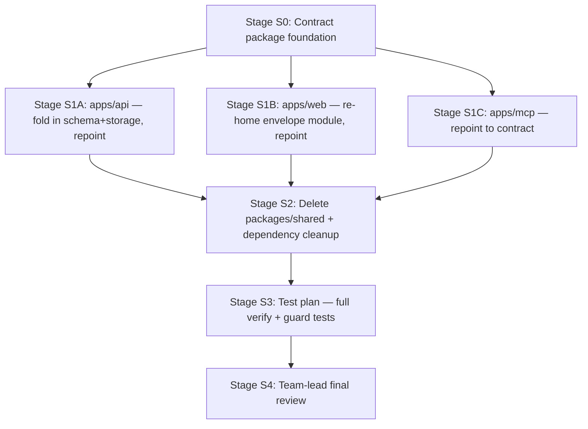

# Dissolve `@primer/shared`: purpose-named packages, a published wire contract, no barrel

## Motivation / Executive Summary

`@primer/shared` is a grab-bag package whose name describes who consumes it ("≥2 files, once") rather than what it is — and that generic name is precisely how it accreted four unrelated things at different trust and deployment boundaries into one module graph. Measured on master: `schema.ts` (22 Drizzle table objects, server DB internals) is imported by **64 files, 100% of them in `apps/api`** — shared with nobody. `storage.ts` (a pure interface) is imported by **3 files, all `apps/api`**. `api.ts` (58 REST wire-contract DTO types) is the only genuinely cross-boundary content, consumed by api, web, and mcp. `companion-protocol.ts` mixes wire-contract anchor shapes with iframe postMessage machinery whose importable half is consumed **only by `apps/web`** — the iframe side (`apps/api/src/companion/v1.js`) is a deliberately standalone sandboxed IIFE that cannot import anything and mirrors the protocol by hand.

The package's barrel (`index.ts` does `export *` of everything) makes the mixed contexts kinetic: 49 `apps/web` files import from the `@primer/shared` root, whose graph includes `schema.ts`'s top-level runtime `import { sql } from 'drizzle-orm'`. Every browser file importing one DTO type therefore pulls a database ORM into web's module graph, and the production bundle ships clean only because Vite tree-shakes it back out — tooling grace, not design. Nothing prevents the next addition to the barrel from putting server-only runtime one bundler-config mistake away from the browser.

The mixed package also blocks publishing. The wire contract is de facto public — `@polygonlabs/primer-mcp` (published to npm) types against it — but `@primer/shared` is structurally unpublishable (`"private": true`, raw `.ts` exports, drizzle peer dep, server internals). PR #79 demonstrated the cost: publishing client types against a private workspace package forced either a declaration bundler (tsup, rejected in review) or hand-duplicated types with a hand-enumerated "drift guard" that cannot be made complete even in principle (type-only exports are not reflectable, so coverage of the guard itself is unverifiable). That PR was closed in favor of fixing the root cause: the contract needs one public home.

This migration dissolves `@primer/shared` entirely: `api.ts`'s DTOs plus the anchor shapes and their two guard functions become **`packages/api-types`**, published as **`@polygonlabs/primer-api-types`** (near-zero runtime — two dependency-free type guards — no peers); `schema.ts` and `storage.ts` fold into `apps/api` where their only consumers live; the postMessage envelope machinery moves into `apps/web` next to its only importer and its existing test file; and the barrel is deleted. Every package is named for what it contains, every import names its real dependency, no app→app edges are introduced, and the published MCP client can type against the same contract definitions the server does — one copy, nothing to drift.

## Benefits

- **Trust-boundary correctness**: server DB internals (`drizzle-orm` runtime, 22 table objects) leave the module graph that browser code imports from. Web's clean bundle stops depending on tree-shaking to remove an ORM: 49 root-barrel import statements in `apps/web` stop resolving through a graph containing `drizzle-orm`.
- **Publishable wire contract**: 58 DTO types + 3 anchor shapes + 2 guards get one public home (`@polygonlabs/primer-api-types`). Kills the PR #79 class of problem permanently — no type duplication, no un-completable drift guards, no declaration bundlers; `@polygonlabs/primer-mcp` and any future consumer resolve the contract from npm.
- **Dependency hygiene**: `@primer/shared`'s `drizzle-orm` peer dependency disappears from web's and mcp's dependency resolution (`strictPeerDependencies: true` currently forces all three apps to satisfy a DB ORM peer contract two of them never use). The new contract package has zero dependencies and zero peers.
- **Import-graph honesty**: 172 import statements audited; 80 root-barrel statements repointed to their true source; 2 mixed-source statements split. `packages/shared`'s missing `./companion-protocol` subpath (which forced 13 statements across all 3 apps through the barrel) becomes moot.
- **Deletion**: `packages/shared` (5 source files, ~1,100 lines incl. the barrel) is removed; the only additions are the contract package (contract content is moved, not written new) and the web-local protocol module (moved). Net new code ≈ package scaffolding only.
- **Accretion resistance**: with no "shared" package there is no default dumping ground; a future cross-app need must name its package for what it is (this migration leaves a worked example of each destination type).
- **Sync-surface visibility**: the untracked v1.js ↔ protocol-module message-shape contract gains explicit "keep in sync" cross-reference comments on both sides, matching the convention every other mirrored pair in v1.js already follows.
- **Guard test coverage**: `isTextRangeAnchor` / `isElementPathAnchor` (previously tested only indirectly through `parseInboundMessage`) gain direct unit tests.

## Implementation Graph



```json make-it-so-stage-index
{
  "version": 2,
  "stages": [
    {
      "id": "S0",
      "name": "Contract package foundation",
      "dependsOn": [],
      "parallelism": "SEQUENTIAL",
      "dispatch": "wave",
      "files": ["packages/api-types/", "apps/api/package.json", "apps/web/package.json", "apps/mcp/package.json", "pnpm-lock.yaml"],
      "owner": "implementation-agent",
      "costExpectation": "minutes",
      "model": "sonnet"
    },
    {
      "id": "S1A",
      "name": "apps/api — fold in schema+storage, repoint imports",
      "dependsOn": ["S0"],
      "parallelism": "PARALLEL",
      "dispatch": "wave",
      "files": ["apps/api/src/", "apps/api/drizzle.config.ts", "apps/api/scripts/build.mjs"],
      "owner": "implementation-agent",
      "costExpectation": "hours",
      "model": "sonnet"
    },
    {
      "id": "S1B",
      "name": "apps/web — re-home envelope module, repoint imports",
      "dependsOn": ["S0"],
      "parallelism": "PARALLEL",
      "dispatch": "wave",
      "files": ["apps/web/src/"],
      "owner": "implementation-agent",
      "costExpectation": "hours",
      "model": "sonnet"
    },
    {
      "id": "S1C",
      "name": "apps/mcp — repoint to contract package",
      "dependsOn": ["S0"],
      "parallelism": "PARALLEL",
      "dispatch": "wave",
      "files": ["apps/mcp/src/", "apps/mcp/scripts/build.mjs"],
      "owner": "implementation-agent",
      "costExpectation": "minutes",
      "model": "haiku"
    },
    {
      "id": "S2",
      "name": "Delete packages/shared + dependency cleanup",
      "dependsOn": ["S1A", "S1B", "S1C"],
      "parallelism": "SEQUENTIAL",
      "dispatch": "wave",
      "files": ["packages/shared/", "apps/api/package.json", "apps/web/package.json", "apps/mcp/package.json", "pnpm-lock.yaml", "README.md"],
      "owner": "implementation-agent",
      "costExpectation": "minutes",
      "model": "haiku"
    },
    {
      "id": "S3",
      "name": "Test plan — full verify + guard tests",
      "dependsOn": ["S2"],
      "parallelism": "SEQUENTIAL",
      "dispatch": "wave",
      "files": ["apps/web/src/companion/protocol.test.ts"],
      "owner": "implementation-agent",
      "costExpectation": "minutes",
      "model": "sonnet"
    },
    {
      "id": "S4",
      "name": "Team-lead final review",
      "dependsOn": ["S3"],
      "parallelism": "SEQUENTIAL",
      "dispatch": "wave",
      "files": ["plans/dissolve-primer-shared.md"],
      "owner": "team-lead",
      "costExpectation": "minutes",
      "model": "fable"
    }
  ]
}
```

## Stage report contract

Implementation agents report completion in exactly this shape (enforced as the structured-output schema on every dispatch):

```json
{
  "stage": "Stage N: <Name>",
  "completed": ["<checklist actions finished>"],
  "filesChanged": ["<paths relative to repo root>"],
  "verifyResults": [{ "cmd": "<exact command run>", "pass": true, "output": "<output tail, on failure only>" }],
  "deviations": ["<anything done differently from the checklist, and why>"],
  "blocked": null
}
```

`deviations` and `blocked` are honesty-forcing: an agent that cannot make a verify condition pass within its declared file set reports `blocked` rather than editing outside its file set or weakening a test. The team lead cross-checks `filesChanged` against the stage's declared files and re-runs every `verifyResults` command post-merge.

## Stage S0: Contract package foundation

Creates `packages/api-types` (published name `@polygonlabs/primer-api-types`) and wires the workspace dependency into all three apps so the parallel wave can repoint against it. The pnpm workspace glob (`packages/*`) picks the new directory up automatically. Repo stays green: nothing imports the new package yet, and `packages/shared` is untouched.

Content contract for `packages/api-types/src/index.ts` (moved verbatim, not rewritten):
- From `packages/shared/src/api.ts`: all 58 exported interfaces/type aliases (lines 3–388), minus its `import type { AnchorData } from './companion-protocol.ts'` line (AnchorData becomes local).
- From `packages/shared/src/companion-protocol.ts`: `TextRangeAnchor` (L14, with its doc comment), `ElementPathAnchor` (L30), `AnchorData` (L40) — the anchor shapes are wire contract (stored in `threads.anchor`, returned by the threads endpoints).
- From `packages/shared/src/companion-protocol.ts`: the runtime guards `isTextRangeAnchor` (L196) and `isElementPathAnchor` (L210), plus private copies of the tiny non-exported helpers they use (`isObject`, `isString`, `isNumber`). These two dependency-free functions are the package's ONLY runtime exports — a contract package shipping its own validators is coherent; consumers: `apps/api` (routes/threads.ts, mcp/tools.ts), `apps/mcp` (format.ts), and `apps/web` (transitively, inside the re-homed parse functions).

Packaging rules (modeled on `apps/mcp/package.json`, the repo's published-package exemplar, per repo conventions): named exports only; `"private"` absent; `publishConfig.access: "public"`; `files: ["dist", "README.md", "LICENSE"]`; `repository.directory: "packages/api-types"`; MIT license file copied from `apps/mcp/LICENSE`; `engines: { "node": ">=20" }` (published standalone, mcp-style — satisfies the root's `engineStrict` on Node 24). Zero dependencies, zero peerDependencies (satisfies `strictPeerDependencies: true` trivially; no `allowBuilds` or `minimumReleaseAge` interaction because no deps are added). Dev-time consumption is raw TS source exactly like `@primer/shared` today (`"types"`/`"main"` → `./src/index.ts`, exports `.` → src); `publishConfig` overrides exports/types/main to `dist/` for the published artifact. Build script: plain `tsc -p tsconfig.build.json` emitting **both** JS and declarations to `dist/` (the guards are runtime, so this is not declaration-only). CI's `pnpm -r run build` picks the build script up automatically.

- [x] **Action**: Create `packages/api-types` with `package.json`, `tsconfig.json` (typecheck, noEmit, matching the compiler options style of `packages/shared/tsconfig.json`), `tsconfig.build.json` (emit JS + declarations to `dist`, `rootDir: src`), `README.md` (what the package is: the Primer REST API wire contract + its validators, single public home), and `LICENSE` (copy of `apps/mcp/LICENSE`). Scripts: `build`, `typecheck`, `test` (echo stub — pure types + two guards; direct guard tests live in the web suite, see Stage S3), `prepublishOnly` = build.
  - **Deviation (executed)**: `packages/api-types/package.json` additionally declares `"typescript": "^6.0.3"` in `devDependencies` — not in the plan's spec, but required for the `build`/`typecheck` scripts to resolve `tsc` at all (pnpm does not hoist another workspace package's binary into a new package's `node_modules/.bin`). Every other workspace package declares the identical devDependency; "zero dependencies, zero peers" refers to runtime deps and is unaffected.
  - **Files**: packages/api-types/package.json, packages/api-types/tsconfig.json, packages/api-types/tsconfig.build.json, packages/api-types/README.md, packages/api-types/LICENSE
  - **Owner**: Implementation agent: contract-package
  - **Verify**: `cat packages/api-types/package.json | node -e "const p=JSON.parse(require('fs').readFileSync(0)); if(p.private) throw new Error('must not be private'); if(!p.publishConfig||p.publishConfig.access!=='public') throw new Error('publishConfig.access');console.log('ok')"` → prints `ok`
- [x] **Action**: Create `packages/api-types/src/index.ts` per the content contract above — move (do not rewrite) the 58 DTO types, 3 anchor shapes, 2 guards + private helpers from `packages/shared/src/{api.ts,companion-protocol.ts}`. Add a header doc comment stating this is the single public home of the REST wire contract. Leave `packages/shared` completely untouched.
  - **Files**: packages/api-types/src/index.ts
  - **Owner**: Implementation agent: contract-package
  - **Verify**: `pnpm --filter @polygonlabs/primer-api-types run typecheck && pnpm --filter @polygonlabs/primer-api-types run build && test -f packages/api-types/dist/index.js && test -f packages/api-types/dist/index.d.ts && ! grep -rn "@primer/shared\|drizzle" packages/api-types/src packages/api-types/dist` → typecheck+build pass, dist artifacts exist, no shared/drizzle references
- [x] **Action**: Add `"@polygonlabs/primer-api-types": "workspace:^"` to `dependencies` of `apps/api/package.json` and `apps/web/package.json`, and to `devDependencies` of `apps/mcp/package.json` (mcp bundles it — types erase, guards inline — exactly as it bundles `@primer/shared` today). Run `pnpm install` to update the lockfile. Do NOT remove `@primer/shared` entries (that is Stage S2).
  - **Files**: apps/api/package.json, apps/web/package.json, apps/mcp/package.json, pnpm-lock.yaml
  - **Owner**: Implementation agent: contract-package
  - **Verify**: `pnpm install && pnpm typecheck` → install succeeds (lockfile updated), repo-wide typecheck green

## Stage S1A: apps/api — fold in schema+storage, repoint imports

`schema.ts` (64 importing files, all already scoped to `@primer/shared/schema`, all runtime table imports, one namespace import at `src/db/client.ts:3`) and `storage.ts` (4 import sites) have exactly one consumer: this app. They move in; every `@primer/shared` import in the app repoints. `packages/shared` remains untouched (deleted in S2), so this stage is green independently of S1B/S1C.

Repoint map (from research, exhaustive; R1 inventory):
- **Schema**: move `packages/shared/src/schema.ts` → `apps/api/src/db/schema.ts` (as a copy; keep the original in place). Its `import type { AnchorData } from './companion-protocol.ts'` becomes `from '@polygonlabs/primer-api-types'`. Repoint all 64 `@primer/shared/schema` import sites to the local module (relative paths, e.g. `../db/schema.ts` — depth varies per file; the typecheck is the arbiter). The namespace import `import * as schema from '@primer/shared/schema'` in `src/db/client.ts` repoints identically; all `schema.*` call sites are unaffected since every table keeps its export name.
- **Storage**: move `packages/shared/src/storage.ts` → `apps/api/src/storage/types.ts` (alongside `src/storage/filesystem.ts`). Repoint 4 sites: `src/app.ts:35`, `src/mcp/tools.ts:4`, `src/storage/filesystem.ts:5` (currently `@primer/shared/storage`), and `src/jobs/purge.ts:5` (currently root barrel).
- **Contract types**: repoint all 39 `api.ts`-sourced import statements (27 root-barrel + 12 already `/api`-scoped; full file:line list in the R1 research inventory — includes the mid-file second import at `src/routes/documents.test.ts:339`) to `@polygonlabs/primer-api-types`.
- **Guards**: `src/mcp/tools.ts:13` and `src/routes/threads.ts:5` (`isTextRangeAnchor, isElementPathAnchor` from root barrel) → `@polygonlabs/primer-api-types`.
- **drizzle.config.ts**: `schema: '../../packages/shared/src/schema.ts'` → `'./src/db/schema.ts'`.
- **scripts/build.mjs**: the esbuild external-filter currently bundles `@primer/shared` (`external.filter((d) => d !== '@primer/shared')`); change the filtered name to `@polygonlabs/primer-api-types` (it must be bundled for the same reason: its dev-time entry is raw `.ts`, which Node cannot load at runtime from `dist/index.js`). Update the strategy comment accordingly.
- **v1.js sync comments**: add the missing "keep in sync" cross-reference: a comment near the top of `apps/api/src/companion/v1.js`'s message-posting section noting the message shapes are mirrored in `apps/web/src/companion/protocol.ts` (post-S1B home) — matching the convention of v1.js's three other explicitly cross-referenced mirrors (v1.js:72, 615, 1592).

- [x] **Action**: Move schema and storage modules into apps/api as specified above (copy files in; do not delete from packages/shared), including the AnchorData import swap inside the moved schema file.
  - **Files**: apps/api/src/db/schema.ts, apps/api/src/storage/types.ts
  - **Owner**: Implementation agent: api-fold
  - **Verify (manual)**: `apps/api/src/db/schema.ts` exports the same 22 table names as `packages/shared/src/schema.ts` (diff the export lists); `apps/api/src/storage/types.ts` exports `Storage` and `StorageKey`.
- [x] **Action**: Repoint every `@primer/shared*` import in apps/api per the repoint map (64 schema sites, 4 storage sites, 39 contract-type statements, 2 guard statements — 109 statements total), and update `drizzle.config.ts` and `scripts/build.mjs` as specified.
  - **Files**: apps/api/src/ (import statements only, per the R1 inventory), apps/api/drizzle.config.ts, apps/api/scripts/build.mjs
  - **Owner**: Implementation agent: api-fold
  - **Verify**: `! grep -rn "@primer/shared" apps/api/src apps/api/drizzle.config.ts apps/api/scripts/build.mjs` → zero matches remain
- [x] **Action**: Add the v1.js ↔ protocol-module "keep in sync" comment described above.
  - **Deviation (executed)**: the comment sits immediately above the `── 1. Init handshake` section header (v1.js:309) — where message posting actually begins — rather than the literal top of file, per the plan's own "near the top of the message-posting section" phrasing.
  - **Files**: apps/api/src/companion/v1.js
  - **Owner**: Implementation agent: api-fold
  - **Verify**: `grep -n "apps/web/src/companion/protocol.ts" apps/api/src/companion/v1.js` → at least one match
- [x] **Action**: Confirm the app is independently green.
  - **Files**: (none — verification only)
  - **Owner**: Implementation agent: api-fold
  - **Verify**: `pnpm --filter @primer/api run typecheck && pnpm --filter @primer/api run build` → both pass

## Stage S1B: apps/web — re-home envelope module, repoint imports

The postMessage envelope machinery's importable half has exactly one consumer: this app. It moves to `apps/web/src/companion/protocol.ts`, next to its existing consumers (`src/companion/client.ts`) and its existing test (`src/companion/protocol.test.ts`). `packages/shared` remains untouched, so this stage is green independently.

Module content for `apps/web/src/companion/protocol.ts` (moved from `packages/shared/src/companion-protocol.ts`):
- Everything EXCEPT what S0 moved to the contract package: i.e. `SerializableRect`, `Anchor`, `Theme`, all `Msg*` interfaces, `OutboundProtocolMessage`, `InboundProtocolMessage`, `MsgCompanionReady`, `MsgCompanionPanic`, `WindowEnvelope`, `parseInboundMessage`, `parseWindowEnvelope`, and the private helpers (`isObject`, `isString`, `isNumber`, `isRect`).
- The anchor shapes and guards it references (`AnchorData`, `TextRangeAnchor`, `ElementPathAnchor`, `isTextRangeAnchor`, `isElementPathAnchor`) are imported from `@polygonlabs/primer-api-types` — the module keeps re-exporting NOTHING from the contract package (consumers import contract names from the contract directly).
- Header comment: this is the parent-side half of the companion protocol; the iframe half is the standalone `apps/api/src/companion/v1.js` (kept in sync by hand — cross-reference comment mirroring the one S1A adds to v1.js).

Repoint map (R1 inventory, exhaustive — 58 statements):
- 10 envelope/anchor statements → relative import of `./companion/protocol.ts`-appropriate path for envelope names; contract names (`AnchorData`, `TextRangeAnchor`, `ElementPathAnchor`) → `@polygonlabs/primer-api-types`. Sites: `src/companion/client.ts:1`, `src/companion/protocol.test.ts:2`, `src/components/ArtifactIframe.tsx:2-8` (two statements), `src/components/NewThreadComposer.tsx:2`, `src/lib/computePillPosition.ts:1`, `src/routes/devHarness.tsx:2-9`, `src/routes/document.tsx:10-17`.
- 2 MIXED statements must be split: `src/queries/mutations.ts:2-7` (`AnchorData` → contract; `CommentDTO, CreateThreadRequest, ThreadDTO` → contract too — all four are contract names, so this becomes a single specifier change) — note: `AnchorData` lives in the contract package, so verify whether a split is actually required or a single `@polygonlabs/primer-api-types` specifier covers all names; same for `src/components/CommentSidebar.tsx:2` (`AnchorData, ThreadDTO`). Expected outcome: no split needed — both statements repoint wholesale to the contract package (the research pre-dated the decision to put anchor shapes in the contract).
- 46 contract-type statements (full file:line list in R1 inventory) → `@polygonlabs/primer-api-types`.
- Fix the stale comment at `src/lib/fitToWidth.ts:5` (mentions `MsgContentMetrics in @primer/shared`) to reference `src/companion/protocol.ts`.

- [x] **Action**: Create `apps/web/src/companion/protocol.ts` per the module-content spec above (moved code, not rewritten; contract names imported from `@polygonlabs/primer-api-types`; sync-comment header included).
  - **Files**: apps/web/src/companion/protocol.ts
  - **Owner**: Implementation agent: web-rehome
  - **Verify**: `grep -n "keep in sync\|v1.js" apps/web/src/companion/protocol.ts` → cross-reference comment present
- [x] **Action**: Repoint all 58 `@primer/shared*` import statements in apps/web per the repoint map (envelope names → relative `protocol.ts` import; contract names → `@polygonlabs/primer-api-types`), and fix the `fitToWidth.ts` comment.
  - **Deviation (executed)**: as the plan itself anticipated, the two "mixed" statements (`queries/mutations.ts`, `components/CommentSidebar.tsx`) needed no split — all their names are contract names, so each repointed wholesale. `routes/devHarness.tsx` and `routes/document.tsx` DID split (envelope names → relative `protocol.ts`; contract names → contract package). `queries/documents.ts` had two now-same-source statements merged into one import from the contract package to avoid a duplicate-import smell.
  - **Files**: apps/web/src/ (import statements per the R1 inventory), apps/web/src/lib/fitToWidth.ts
  - **Owner**: Implementation agent: web-rehome
  - **Verify**: `! grep -rn "@primer/shared" apps/web/src` → zero matches remain
- [x] **Action**: Confirm the app is independently green, including its existing protocol tests against the moved module.
  - **Files**: (none — verification only)
  - **Owner**: Implementation agent: web-rehome
  - **Verify**: `pnpm --filter @primer/web run typecheck && pnpm --filter @primer/web run test && pnpm --filter @primer/web run build` → all pass (21 test files, incl. `protocol.test.ts` now importing the local module)

## Stage S1C: apps/mcp — repoint to contract package

Five statements, fully mapped. `@primer/shared` is a devDependency here (bundled at publish); after this stage the app types and bundles against the contract package instead. Green independently.

- [x] **Action**: Repoint the 4 `@primer/shared/api` type-import statements (`src/client.ts:1-8`, `src/deviceLogin.ts:1`, `src/format.test.ts:2`, `src/format.ts:1`) and the 1 root-barrel guard import (`src/format.ts:2` — `isElementPathAnchor, isTextRangeAnchor`) to `@polygonlabs/primer-api-types`.
  - **Files**: apps/mcp/src/client.ts, apps/mcp/src/deviceLogin.ts, apps/mcp/src/format.ts, apps/mcp/src/format.test.ts
  - **Owner**: Implementation agent: mcp-repoint
  - **Verify**: `! grep -rn "@primer/shared" apps/mcp/src` → zero matches remain
- [x] **Action**: Update `apps/mcp/scripts/build.mjs`: the esbuild external-filter that bundles `@primer/shared` now has nothing to filter once S2 removes the dep, but this stage must keep the bundle correct for the NEW package — since `@polygonlabs/primer-api-types` sits in `devDependencies` it is already absent from the externals list (which is built from `dependencies` only) and gets bundled automatically. Replace the `'@primer/shared'` filter and its strategy comment with a comment explaining that `@polygonlabs/primer-api-types` is bundled by virtue of being a devDependency (guards inline, types erase).
  - **Files**: apps/mcp/scripts/build.mjs
  - **Owner**: Implementation agent: mcp-repoint
  - **Verify**: `! grep -n "@primer/shared" apps/mcp/scripts/build.mjs` → zero matches
- [x] **Action**: Confirm the app is independently green and the published bundle self-contains the guards.
  - **Files**: (none — verification only)
  - **Owner**: Implementation agent: mcp-repoint
  - **Verify**: `pnpm --filter @polygonlabs/primer-mcp run typecheck && pnpm --filter @polygonlabs/primer-mcp run test && pnpm --filter @polygonlabs/primer-mcp run build && ! grep -n "@primer/shared\|@polygonlabs/primer-api-types" apps/mcp/dist/index.js` → typecheck/test/build pass; dist bundle contains no unresolved references to either package name (guards inlined)

## Stage S2: Delete packages/shared + dependency cleanup

All three consumers are off the package (S1A/S1B/S1C committed). Delete it and remove every remaining reference.

- [x] **Action**: Delete the `packages/shared` directory entirely. Remove the `"@primer/shared": "workspace:*"` entries from `apps/api/package.json` (dependencies), `apps/web/package.json` (dependencies), and `apps/mcp/package.json` (devDependencies). Run `pnpm install` to update the lockfile (drops the three link entries and the `packages/shared` importer section).
  - **Files**: packages/shared/ (deleted), apps/api/package.json, apps/web/package.json, apps/mcp/package.json, pnpm-lock.yaml
  - **Owner**: Implementation agent: cleanup
  - **Verify**: `test ! -d packages/shared && pnpm install && ! grep -rn "@primer/shared" --include="*.ts" --include="*.tsx" --include="*.mjs" --include="*.json" --exclude-dir=node_modules --exclude-dir=dist --exclude-dir=docs apps packages *.json` → directory gone, install green, zero live references (docs/superpowers historical design docs are deliberately excluded — they are records, not build inputs)
- [x] **Action**: Update the root `README.md` Architecture section: replace the `packages/shared` bullet (line ~62) with bullets for `packages/api-types` (published wire contract + validators) and note schema/storage now live in `apps/api`, the companion protocol module in `apps/web`.
  - **Files**: README.md
  - **Owner**: Implementation agent: cleanup
  - **Verify**: `grep -n "api-types" README.md && ! grep -n "packages/shared" README.md` → new bullet present, stale bullet gone
- [x] **Action**: Confirm the whole workspace is green without the package.
  - **Files**: (none — verification only)
  - **Owner**: Implementation agent: cleanup
  - **Verify**: `pnpm typecheck && pnpm -r run build` → all workspace members pass (CI runs exactly these)

## Stage S3: Test plan — full verify + guard tests

Runs the full repo verification exactly as CI does (typecheck → build → test, with the api suite against real Postgres), and adds the one genuinely new test surface this migration creates: direct unit tests for the contract package's guards, which were previously exercised only indirectly.

Environment: requires the Docker daemon. `pnpm db:up` starts the compose Postgres (image `postgres:17.9`, hosts both `primer` and `primer_test` databases via `docker/init-db.sql`); `pnpm db:migrate:test` applies migrations to `primer_test`. If the daemon is unavailable, this stage is **blocked** (never skipped, never "verified partially").

- [ ] **Action**: Add a `describe('anchor guards (from @polygonlabs/primer-api-types)')` block to `apps/web/src/companion/protocol.test.ts` importing `isTextRangeAnchor` and `isElementPathAnchor` directly from `@polygonlabs/primer-api-types`, covering: position-shape acceptance (`start`/`end` numbers, `end > start`), legacy-shape acceptance (`prefix`/`suffix`/`containerPath` strings), rejection of `end <= start`, rejection of non-objects and wrong `type` tags, and element-path acceptance/rejection on `path`/`innerHash` presence. (These live in the web suite deliberately: the contract package keeps a test stub, and the web suite is where every other protocol behavior is already pinned — no new test infrastructure for two functions.)
  - **Files**: apps/web/src/companion/protocol.test.ts
  - **Owner**: Implementation agent: test-plan
  - **Verify**: `pnpm --filter @primer/web run test` → passes with the new describe block included
- [ ] **Action**: Run the full CI-equivalent verification against real Postgres.
  - **Files**: (none — verification only)
  - **Owner**: Implementation agent: test-plan
  - **Verify**: `pnpm db:up && pnpm db:migrate:test && pnpm typecheck && pnpm -r run build && pnpm test` → every step passes (api: 67 test files against `primer_test`; web: 21; mcp: 5)

## Monitoring verification stage — omitted

Research confirmed `packages/shared` contains zero monitored signals: no error classes, no `this.name =` assignments, no log emissions, nothing a dashboard or monitor could key on (the `MsgCompanionLog` type is a message shape, not an emitted signal). Per the empty-category rule, no monitoring stage exists in this plan.

## Stage S4: Team-lead final review

- [ ] **Action**: Cross-check every stage's committed diff against its declared file set; confirm every checklist box above is ticked in the plan document as committed; re-run the S3 full verification one final time on the assembled branch; write the completion report (stages, verify results, diff summary).
  - **Files**: plans/dissolve-primer-shared.md
  - **Owner**: Team lead
  - **Verify**: `pnpm typecheck && pnpm -r run build && pnpm test` → green on the final assembled branch
- [ ] **Action**: Do NOT open a pull request. Report the end state to the user and ask whether to push + open the draft PR (with this plan's Motivation section as the description) or review locally first.
  - **Files**: (none)
  - **Owner**: Team lead
  - **Verify (manual)**: The branch is local-only at completion; no `git push` has occurred.

## Execution prerequisites

- **Branch**: work happens on `refactor/dissolve-shared` in the worktree at `/Users/dcollins/apps-team-workspace/repositories/primer/.claude/worktrees/dissolve-shared`, branched off `origin/master`. Before the first stage commit: `git -C <worktree> fetch origin`, confirm `git -C <worktree> branch --show-current` = `refactor/dissolve-shared`, and confirm `git -C <worktree> log --oneline origin/master..HEAD` shows only this plan's commits. Use `git -C <absolute-path>` for every git command — never rely on CWD.
- **Worktree isolation for the parallel wave** (S1A/S1B/S1C): each implementation agent runs with `Agent isolation: "worktree"` (or the wave is compiled into a `Workflow` with `agent(..., { isolation: 'worktree' })`). The shell's CWD must be inside the dissolve-shared worktree at dispatch time so isolation resolves against the primer repo. Fresh worktrees have no `node_modules`: every agent brief includes `pnpm install --frozen-lockfile` before any verify. Never let two file-editing agents share one checkout.
- **Repo-green commits**: there are no git hooks in this repo (verified), but the doctrine stands on its own — every stage commit must leave `pnpm typecheck` green (the stage definitions above are drawn so this holds at every boundary).
- **No versioning artifacts**: this repo does not use changesets (verified) — no version files ride with stages. `packages/api-types` starts at `0.1.0`; its first npm publish is a post-merge, maintainer-driven step outside this plan.

## Execution mechanics

The unit of dispatch is the wave, read off the Mermaid graph: **Wave 1** = S0 alone (single-stage wave → plain `Agent` dispatch, model per Stage Index). **Wave 2** = S1A + S1B + S1C compiled into a single ephemeral `Workflow` — one `agent()` per stage, `isolation: 'worktree'`, `schema` = the stage report contract above, `model` copied verbatim from the Stage Index. Derive the workflow script at execution time; never commit it. **Wave 3** = S2, **Wave 4** = S3 (single-stage waves), **Wave 5** = S4 (team lead directly).

> **Deviation (executed) — Wave 2 degraded to sequential single-checkout dispatches.** The executing session had no `Workflow` tool available, and `Agent` worktree isolation could not be aimed at the primer repo: the harness resolves isolation from the shell CWD at spawn, the session's CWD reset to the workspace root between Bash calls (so isolation would have targeted the workspace repo), and isolated worktrees branch from `origin/master`, which lacks this run's local-only stage commits. Per the skill's documented Phase 3 degradation, S1A → S1B → S1C were dispatched **sequentially** as plain `Agent` calls operating directly in the dissolve-shared working tree — one file-editing agent at a time, models still pinned verbatim from the Stage Index, report contract requested as structured JSON output (not schema-enforced, so the team lead's post-merge re-verification is the binding gate, as it already was).

Briefs are content-keyed: each stage brief embeds the plan blob hash (`git hash-object plans/dissolve-primer-shared.md`), the stage id, the base tree hash (`git rev-parse HEAD^{tree}` at wave start), the stage's verify commands quoted verbatim, a `READ FIRST:` mount of the plan's stage section by path and heading, and run-specific data (worktree path, report schema) only. Agents own *how* verify conditions reach green within their declared file set; they never run git mutations, never edit outside the file set, and report `blocked` rather than weakening a gate.

After each wave returns: the team lead cross-checks reports against declared file sets, reads the diffs, merges worktree branches (main session, never delegated), re-runs every verify command post-merge, ticks the stage's checkboxes in this document, folds reported deviations into the plan text, and makes the per-stage commits — plan update in the same commit. A `blocked` report or `null` result goes to the team lead for adjudication: re-dispatch, pull a minimal slice forward, or revise the plan — never patch around it inside a workflow.

## Team structure

- **Team lead**: the executing session. Owns: wave compilation, diff review, worktree merges, conflict resolution, all git operations, checkbox updates, per-stage commits, failure adjudication, and the final report. Never delegates merge/commit/review to a subagent.
- **Implementation agents**: full-capability `general-purpose` agents (never Explore agents), one per stage, models pinned per the Stage Index. They make file changes only — no `git commit`/`push`/`merge`, no versioning commands. Completion is signaled exclusively via the stage report contract (enforced as structured output on every dispatch).

## Commit policy

- One commit per completed stage, made by the team lead once every checklist item in that stage passes verification — intentional and autonomous; the team lead does not pause to re-ask between stages. Proceeding to execution is the commit permission for this run.
- The stage commit updates this plan document: tick the stage's `- [ ]` boxes and fold in deviations, in the same commit as the code. The plan's checkbox state at any commit is the authoritative progress record — this is what resume reads.
- Commit messages follow Conventional Commits with the stage name: `feat(api-types): Stage S0 — contract package foundation`, `refactor(api): Stage S1A — fold in schema+storage, repoint imports`, `refactor(web): Stage S1B — re-home envelope module`, `refactor(mcp): Stage S1C — repoint to contract package`, `refactor(shared): Stage S2 — delete packages/shared`, `test: Stage S3 — full verify + guard tests`.
- Do not reorganize or squash the branch; per-stage history is preserved on purpose. Do not push; do not open a PR (Stage S4 hands that decision to the user).

## Risks & sequencing (informative)

- **Open-branch collisions** (measured): spike PR #75 (`spike/agent-messages`) edits `packages/shared/src/{companion-protocol,schema}.ts` in place — the two files this migration relocates. Issue #78 (the #75 re-spec) must be implemented AFTER this migration lands, against the new homes (`apps/web/src/companion/protocol.ts`, `apps/api/src/db/schema.ts`), or its spike diff re-applied there. Open PR #76 (`feat/mcp-content-path`) touches `apps/mcp/src/client.ts` + `apps/mcp/package.json`; whichever of #76 and this migration merges second rebases over a small, mechanical conflict (import-specifier lines and a dependency entry). Neither collision changes this plan's content — they are merge-time sequencing facts.
- **Railway deploy**: no Dockerfile exists; Railway's Railpack builds the whole monorepo and starts via `pnpm start`. Package relocation is transparent to it. The `STATIC_ROOT` default in `apps/api/src/app.ts` (serves `apps/web/dist` off disk) is untouched by this migration.
- **npm publish of `@polygonlabs/primer-api-types`** is intentionally out of scope (maintainer action post-merge). Until it is published, `@polygonlabs/primer-mcp` cannot ship a release that externalizes the contract package — irrelevant today because mcp bundles it (devDependency), exactly as it bundled `@primer/shared`.
